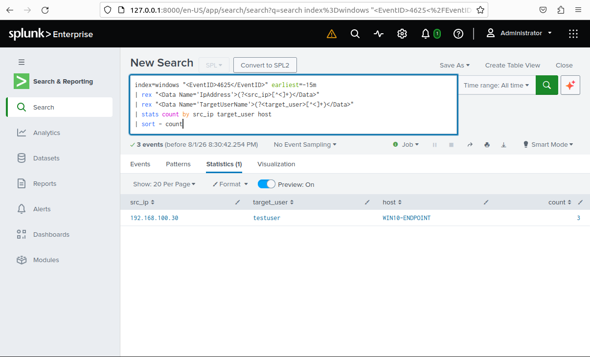
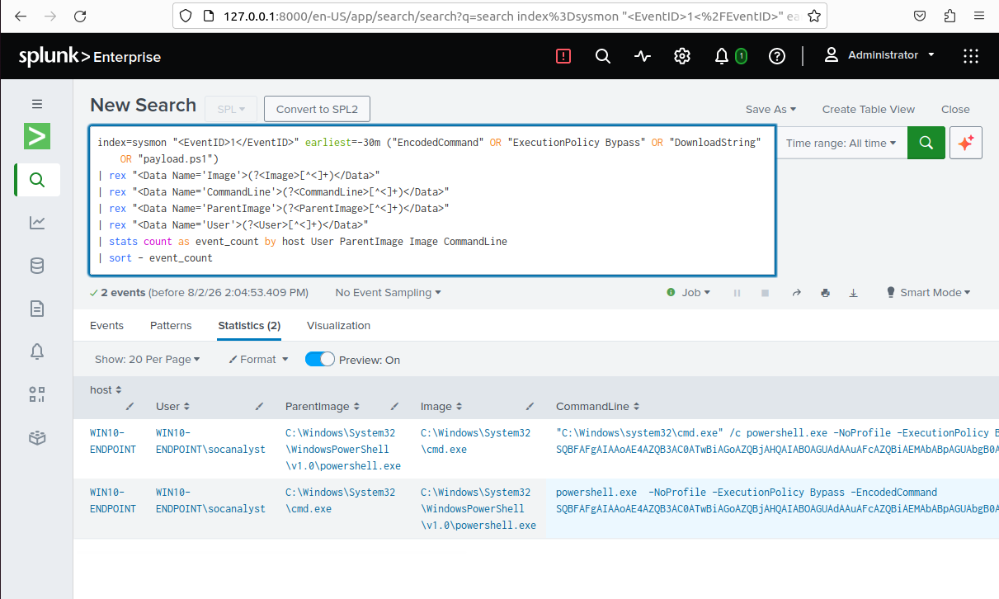
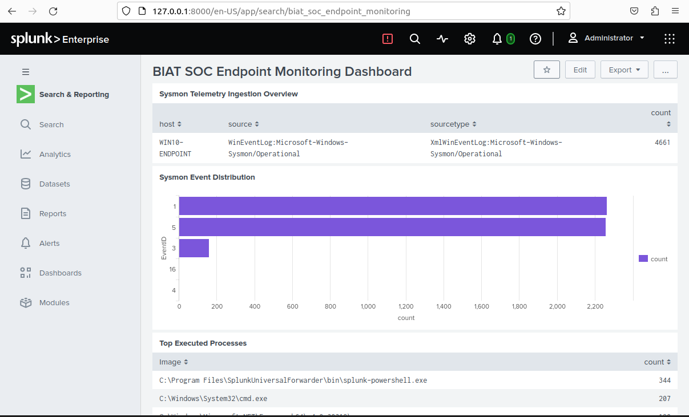
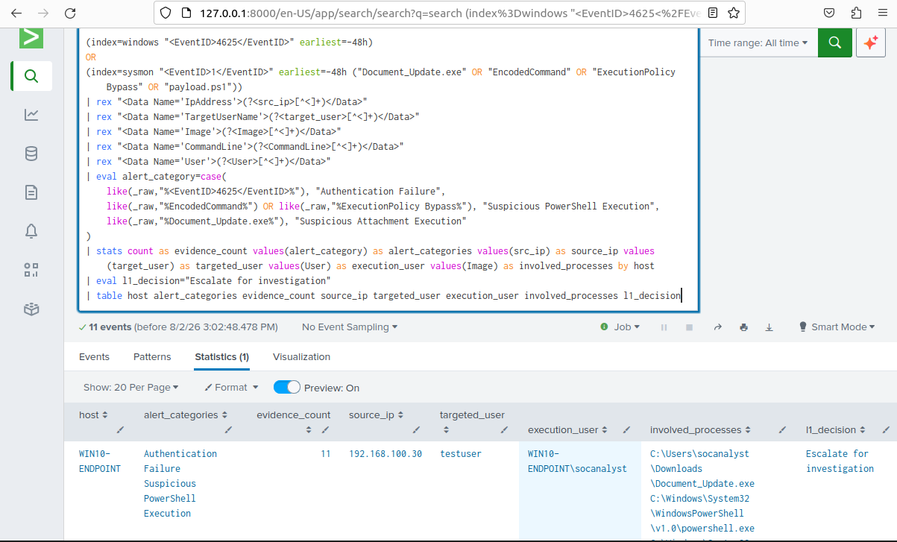

# SOC Analyst L1 Home Lab: Splunk SIEM, Sysmon and Attack Detection

A hands-on Security Operations Center (SOC) lab I built during my internship. I deployed a Splunk SIEM, sent Windows and Sysmon telemetry to it, simulated three common attacks from a Kali Linux machine, and then detected, investigated and escalated them the way a SOC L1 analyst would.

> **Disclaimer:** This is an isolated **home-lab simulation** built on VirtualBox for training purposes. It contains **no real BIAT systems, data, network information or confidential material**. All hosts, users and IPs (`192.168.100.0/24`, `testuser`, `WIN10-ENDPOINT`) are lab-only. Lab passwords visible in screenshots have been redacted.

---

## Lab Architecture

```
        ┌─────────────────────── Internal network "BIAT-SOC-LAB" (192.168.100.0/24) ───────────────────────┐
        │                                                                                                   │
  ┌─────────────────┐        RDP brute force / payload hosting        ┌──────────────────────────┐          │
  │  Kali Linux      │ ─────────────────────────────────────────────► │  Windows 10 Endpoint      │          │
  │  (Attacker)      │                                                 │  WIN10-ENDPOINT           │          │
  │  192.168.100.30  │                                                 │  Sysmon + Splunk UF       │          │
  └─────────────────┘                                                 │  192.168.100.20           │          │
                                                                       └────────────┬─────────────┘          │
                                                                                    │ logs → TCP 9997         │
                                                                       ┌────────────▼─────────────┐          │
                                                                       │  Ubuntu Splunk Server     │          │
                                                                       │  Splunk Enterprise (8000) │          │
                                                                       │  192.168.100.10           │          │
                                                                       └──────────────────────────┘          │
        └───────────────────────────────────────────────────────────────────────────────────────────────────┘
```

| Machine | Role | IP |
|---|---|---|
| Ubuntu: `splunk-server` | Splunk Enterprise (SIEM), receives logs on port 9997 | 192.168.100.10 |
| Windows 10: `WIN10-ENDPOINT` | Monitored endpoint: Sysmon + Splunk Universal Forwarder | 192.168.100.20 |
| Kali Linux | Attacker machine | 192.168.100.30 |

## Tools and Skills

- **SIEM:** Splunk Enterprise, SPL (`rex`, `stats`, `eval`/`case`, `table`, timelines), custom dashboards
- **Telemetry:** Sysmon (Event IDs 1, 3), Windows Security logs (4624, 4625), Splunk Universal Forwarder
- **Offensive simulation:** Kali Linux, Hydra (RDP brute force), encoded PowerShell payloads
- **SOC workflow:** alert validation, IOC/IOA extraction, process-tree correlation, severity triage, escalation reporting
- **Framework:** MITRE ATT&CK (T1110, T1059.001, T1105)
- **Infrastructure:** VirtualBox, internal networking, Windows and Linux administration

## Project Phases

| # | Phase | Screenshots |
|---|---|---|
| 1 | VirtualBox internal network setup | [`01_VirtualBox`](screenshots/01_VirtualBox) |
| 2 | Windows endpoint configuration (hostname, static IP) | [`02_Windows_Endpoint`](screenshots/02_Windows_Endpoint) |
| 3 | Splunk Enterprise install and receiving port 9997 | [`03_Splunk`](screenshots/03_Splunk) |
| 4 | Sysmon + Universal Forwarder deployment | [`04_Sysmon_Forwarder`](screenshots/04_Sysmon_Forwarder) |
| 5 | Log ingestion and connectivity validation | [`05_Log_Validation`](screenshots/05_Log_Validation) |
| 6 | Attack simulations (3 scenarios) | [`06_Attack_Scenarios`](screenshots/06_Attack_Scenarios) |
| 7 | SOC endpoint monitoring dashboard | [`07_SOC_Investigation`](screenshots/07_SOC_Investigation) |
| 8 | SOC L1 investigation workflow | [`08_Investigation_Workflow`](screenshots/08_Investigation_Workflow) |
| 9 | Incident report and L2 escalation | [`09_Incident_Report_SOC_L2`](screenshots/09_Incident_Report_SOC_L2) |
| 10 | SOC L1 cheat sheet | [`10_SOC_L1_Cheat_Sheet`](screenshots/10_SOC_L1_Cheat_Sheet) |

## Attack Scenarios and Detections

### 1. RDP Brute Force (T1110)
Hydra was run from Kali against RDP on the Windows endpoint. I detected it with **Event ID 4625** (failed logon), extracted the source IP and target user with `rex`, and confirmed the RDP connections (port 3389) with **Sysmon Event ID 3**.

```spl
index=windows "<EventID>4625</EventID>"
| rex "<Data Name='IpAddress'>(?<src_ip>[^<]+)</Data>"
| rex "<Data Name='TargetUserName'>(?<target_user>[^<]+)</Data>"
| stats count as failed_attempts by src_ip target_user host
| sort - failed_attempts
```



### 2. Phishing Attachment Simulation (T1059.001)
A fake attachment, `Document_Update.exe`, launched hidden encoded PowerShell. I detected it with **Sysmon Event ID 1** by looking at the parent/child process relationship.

### 3. Suspicious Encoded PowerShell + Payload Download (T1059.001, T1105)
A payload hosted on Kali was fetched with `DownloadString` and run with `-ExecutionPolicy Bypass -EncodedCommand`. I detected it by searching command lines for those indicators.

```spl
index=sysmon "<EventID>1</EventID>" ("EncodedCommand" OR "ExecutionPolicy Bypass" OR "DownloadString")
| rex "<Data Name='Image'>(?<Image>[^<]+)</Data>"
| rex "<Data Name='CommandLine'>(?<CommandLine>[^<]+)</Data>"
| rex "<Data Name='ParentImage'>(?<ParentImage>[^<]+)</Data>"
| table _time host ParentImage Image CommandLine
```



## SOC Monitoring Dashboard

A custom Splunk dashboard showing Sysmon ingestion, event distribution, top processes, PowerShell activity and network connections.



## Investigation and Escalation

I followed a full L1 workflow: validate the alert, collect evidence, build a timeline, correlate the process tree, summarize the source IP, and make a final decision. One correlation search combines the authentication failures and the suspicious executions into a single verdict, **Escalate to SOC L2**.



## Deliverables

- [Incident Report INC-2026-001: SOC L1 to L2 escalation](reports/INC-2026-001_SOC_L1_Escalation.txt)
- [SOC Analyst L1 Cheat Sheet](docs/SOC_L1_Cheat_Sheet.txt): event IDs, SPL searches, IOC vs IOA, severity matrix, investigation checklist

## Repository Structure

```
.
├── README.md
├── reports/        # Incident report (L1 → L2 escalation)
├── docs/           # SOC L1 cheat sheet
└── screenshots/    # Evidence for every phase, numbered in order
```

## Author

**Razi Ammari**
